<div align="center">
  

  

  <br/>

  
  
</div>

<br/>

## `> whoami`

```text
name      : Jhon Moises A. Cabiling
school    : Batangas State University (BS Computer Science, 2nd year)
focus     : Java · Python · problem solving · building useful things
goal      : full-stack + AI engineer
status    : learning, shipping, repeating
```

I like turning "I wish this existed" into working code. I'm early in my journey,
so this profile is a public log of what I'm learning and building.

<br/>

## `> stack --loaded`

<div align="center">
  
</div>

<br/>

## `> ls ./featured-projects`

<table>
  <tr>
    <td width="50%" valign="top">
      <h3>🗡️ MindQuest</h3>
      <p>A Java study game where monsters quiz you on your own notes. Upload a lesson, battle orcs, elves, liches and werewolves, and win by answering correctly.</p>
      <p><code>Java</code> <code>OOP</code> <code>Game Logic</code></p>
      <a href="https://github.com/YOURUSERNAME/MindQuest">View repo →</a>
    </td>
    <td width="50%" valign="top">
      <h3>📡 OffGrid</h3>
      <p>An offline, local-AI emergency info hub for communities during outages. Built for the AppBuildersPH 2026 hackathon.</p>
      <p><code>Local AI</code> <code>Offline-first</code> <code>Hackathon</code></p>
      <a href="https://github.com/YOURUSERNAME/OffGrid">View repo →</a>
    </td>
  </tr>
</table>

<br/>

## `> cat now.txt`

- 🔭 Learning: data structures and algorithms, then web development
- 🛠️ Building: MindQuest and OffGrid
- 🎯 Next: ship one project with a live demo
- 🤝 Open to: team projects, hackathons, and `good first issue` contributions

<br/>

## `> stats`

<div align="center">
  
  
</div>

<br/>

## `> connect`

<div align="center">
  <a href="https://www.linkedin.com/in/YOURLINK"></a>
  <a href="mailto:you@email.com"></a>
</div>

<br/>

<div align="center">
  
</div>
